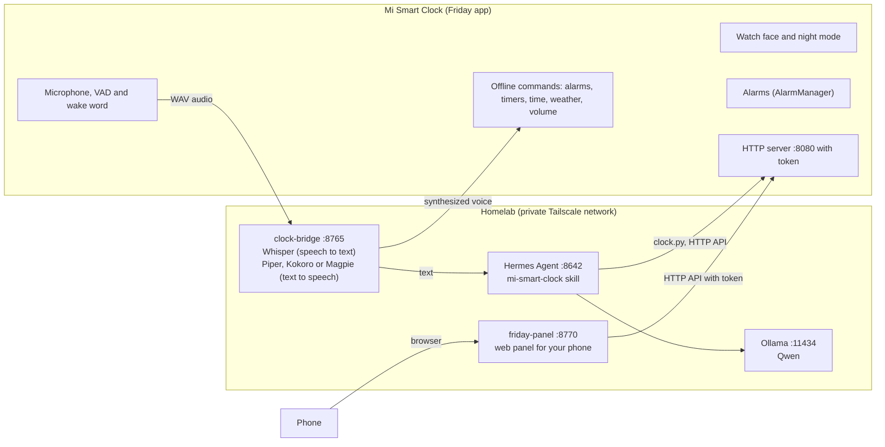
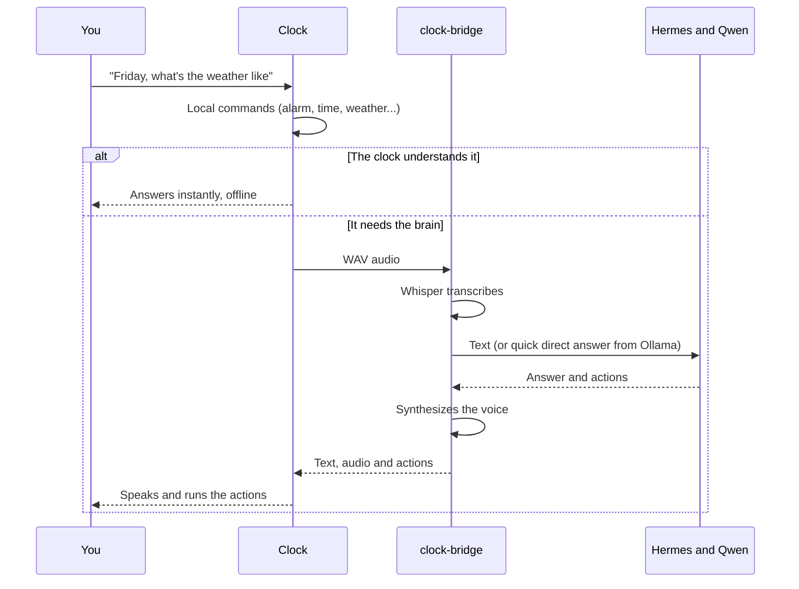

English | [Español](README.es.md)

<div align="center">

# Friday

### Your own alarm clock and voice assistant, Google-free, on a Xiaomi Mi Smart Clock

<sub>Xiaomi Mi Smart Clock (model X04G / LX04, MediaTek MT8167) &middot; root, no Google, local voice assistant, Hermes Agent, Ollama, Tailscale</sub>


<br>


<br>

**A fail-safe alarm clock, a voice assistant that runs in your home, and a web panel for your phone.**
The brain is Hermes Agent with Qwen (Ollama) on your homelab. Clock and homelab talk over Tailscale.

</div>

---

## Contents

- [What is Friday](#what-is-friday)
- [Screenshots](#screenshots)
- [Architecture](#architecture)
- [How it was built](#how-it-was-built)
- [Tools and technologies](#tools-and-technologies)
- [Installation guide](#installation-guide)
  - [What you need](#what-you-need)
  - [Part A: set up the brain on the homelab](#part-a-set-up-the-brain-on-the-homelab)
  - [Part B: free the clock and install Friday](#part-b-free-the-clock-and-install-friday)
  - [Part C: connect everything and test](#part-c-connect-everything-and-test)
- [What Friday does](#what-friday-does)
- [Security and privacy](#security-and-privacy)
- [Development and testing](#development-and-testing)
- [Troubleshooting](#troubleshooting)
- [Roadmap](#roadmap)
- [Documentation](#documentation)
- [Credits and licenses](#credits-and-licenses)

> [!NOTE]
> The documents under `docs/` linked from this README are written in Spanish.

---

## What is Friday

The **Xiaomi Mi Smart Clock (X04G)** is a bedside clock with a 4-inch touchscreen, a microphone, a speaker and Android 10, but it is tied to Google Assistant and the Xiaomi cloud. **Friday** turns it into a device that is entirely yours:

| | |
|---|---|
| **An alarm clock that does not fail** | Alarms live in the system (`AlarmManager.setAlarmClock()`), not on the network. If the homelab or the wifi goes down, they ring anyway. They survive reboots and time changes. |
| **A private voice assistant** | Speech is transcribed (Whisper) and synthesized (Piper, Kokoro or Magpie) on your own server. Nothing goes to Google or to any voice cloud. |
| **A brain you choose** | Hermes Agent with a local Qwen model (Ollama). It understands free-form commands, uses tools and controls the clock from any channel: Telegram, a cron job or the clock itself. |
| **A customizable watch face** | Themes, grid screens, per-hour profiles, photos, carousels, layers and gestures. You design it from your phone with a preview identical to the clock's. |
| **A web panel for your phone** | Alarms with a time wheel, settings, the design editor and the live clock. Same design system as the clock: black, amber, Inter and Lucide icons. |
| **Lightweight on purpose** | The app has no runtime dependencies (no AppCompat, no Compose, no OkHttp, no Play Services): only the Android framework, to run well on 1 GB of RAM. |

Design principles that guide the whole project:

1. **The alarm clock depends on nothing external.** Everything else may fail; waking you up may not.
2. **The important things are understood on the clock itself.** Commands for alarms, timers, time, weather and volume are interpreted in Spanish and without a language model. Only the rest goes to Hermes.
3. **Privacy by default.** Local voice, token-protected API and listening only on the private network.
4. **Everything is reversible.** Google packages are disabled, never uninstalled; there is a full backup and a rollback.
5. **If something fails, something else covers for it.** If the watch face WebView fails, the native watch face comes back. If the bridge voice is missing, the clock uses its own TTS. If the GSI has no ringtones, the alarm rings with beeps.

---

## Screenshots

The web panel, designed mobile-first. From left to right: Home (with the live clock), alarm list, alarm editor with the time wheel, screen editor with the fixed preview, and Settings.


> [!NOTE]
> The screenshots use sample data from a simulated clock. The real clock's watch face shows the design you choose, with your photos if you like.

---

## Architecture

Four independent pieces that talk over HTTP.



| Piece | Where it lives | What it does |
|---|---|---|
| **Friday app** (`app-android/`) | On the clock | Launcher, watch face, alarms, assistant, HTTP server. Kotlin, UI built in code. |
| **Screen engine** (`app-android/src/main/assets/face/`) | Inside the app (WebView) and copied to the panel | Draws the watch face and the alarm screen from a JSON design. The same preview on the clock and in the panel. |
| **clock-bridge** (`homelab/clock-bridge/`) | Homelab | The clock's ears and mouth: Whisper, TTS, the wake word gate and question routing. |
| **Hermes skill** (`hermes-skill/`) | Homelab (in Hermes) | Gives Hermes control of the clock: alarms, speak, display, Bluetooth, settings and design. Includes a typed-tools plugin for the clock channel, with no terminal ([`docs/hermes-seguro.md`](docs/hermes-seguro.md), in Spanish). |
| **Web panel** (`homelab/friday-panel/`) | Homelab | Mobile-first interface. The clock token never leaves the server. |
| **Device kit** (`device-kit/`) | Your computer | Numbered scripts to free the clock, with backup and rollback. |

### The flow of a voice question



### A single action layer, three entry points

In the app, `Actions.kt` is the only place that executes clock actions (alarms, timers, speak, display, volume, Bluetooth, design...). It is reused by:

- **Local commands** (`LocalIntents.kt`): interpret alarms, timers, time, weather and volume in Spanish, offline and without a model.
- **Brain replies** (`Backend.kt`): whatever the clock does not understand goes to the bridge and to Hermes, which returns text and a list of actions.
- **HTTP API** (`Api.kt`): what Hermes, the panel and `clock.py` use. Documented in [`docs/api.md`](docs/api.md) (in Spanish).

---

## How it was built

### 1. The starting point: freeing the hardware

The clock is a **MediaTek MT8167** with four Cortex-A35 cores and **1 GB of RAM**, an 800x480 touchscreen, dual microphones, a mono speaker and three physical buttons. From the factory it runs Android Go 10 with Google Assistant.

The chosen path, with the reasons in [`docs/decisions.md`](docs/decisions.md) and the research notes in [`docs/research-notes.md`](docs/research-notes.md) (both in Spanish):

- **Full, verified backup** of all partitions before touching anything, with `mtkclient` in BROM mode.
- **Unlock the bootloader** and flash a **Magisk-patched `boot`** built from the clock's own `boot` (not the third-party one, which ships an open root shell on port 1337).
- **Disable Google, never uninstall it** (`pm disable-user`), in a reversible way.
- Make **Friday the launcher** of the clock.
- Everything with numbered scripts (`00_preflight` to `07_smoke_test`, plus `99_rollback`) that start in **dry-run mode** (`DRY_RUN=1`) and ask you to type a word for destructive steps.

### 2. The clock app

Kotlin 1.9 with `minSdk 26` and `targetSdk 34`, **no runtime dependencies**. The native interface is built in code (`ui/Ui.kt`), with no XML layouts. Main pieces:

- **Alarms** (`alarm/`): `AlarmManager.setAlarmClock()`, a sound service with progressive volume and a sunrise screen, and a `BootReceiver` that reschedules after a reboot. They never depend on the network.
- **Assistant** (`assistant/`): recording with voice activity detection (VAD), the "Friday" wake word, continuous conversation, TTS from the bridge or from the system.
- **HTTP server** (`server/`): a minimal custom server, with token. By default it listens on all interfaces; turn on "Tailscale only" in Settings to restrict it.
- **Watch face**: an HTML and JavaScript engine inside a `WebView`, with a native fallback if it fails.
- **Weather** with Open-Meteo (no API key), **Bluetooth** as the phone's speaker and **brightness** with its own rule between panel and clock.

### 3. The screen engine

The watch face and the alarm screen are described in a **JSON design** strictly validated (all or nothing) by `DesignSchema.kt`: themes, screens on an 8 by 6 grid, per-hour profiles and the alarm screen. The same engine, written in classic JavaScript (the clock's `WebView` is Chrome 74), runs on the clock and, copied with `tools/sync-face.sh`, in the panel preview. A version (a hash of the engine files) makes it possible to warn when clock and panel differ.

It has deliberate safety nets: a check that the engine started, a load time limit, recovery if the rendering process dies, and a fallback to the native watch face. **Alarms never depend on the WebView.**

### 4. The brain and the voice on the homelab

- **`clock-bridge`** (FastAPI): `/v1/stt` with faster-whisper, `/v1/wake` as the wake word gate, `/v1/assist` for asking questions. It routes each question: a calculator solves spoken arithmetic instantly, topics that need tools go to **Hermes**, and the rest goes straight to **Ollama** with a short prompt and no reasoning (from 9 s down to 0.4 s in the project's measurement on a GTX 1060).
- **Hermes Agent** with a local **Qwen** as the model, and the **`mi-smart-clock` skill** to control the clock from any channel.
- **Output voice** configurable with three engines that chain as fallbacks: Magpie (NVIDIA), Kokoro and Piper.

### 5. The web panel

A **mobile-first** application, in vanilla JavaScript with no libraries and with FastAPI as a proxy: the clock token stays on the server, requests carry an anti-CSRF header and the password is optional. It has four tabs (Home with the live clock, Alarms with a time wheel, Screens with the fixed preview, and Settings) and automated tests that prevent emojis, stray colors or nonexistent icons from slipping in.

### 6. The "Obsidiana" design system

A single source of truth (`design-system/tokens.json`) generates the colors of the clock, the engine and the panel: true black (OLED friendly), a single amber accent, **Inter** typography with tabular numbers and **Lucide** icons with a uniform stroke. The contrast of every color pair is checked in the tests. More in [`docs/sistema-de-diseno.md`](docs/sistema-de-diseno.md) (in Spanish).

### 7. The development process

The project was built in phases and subprojects, each with its specification, its plan and its tests, which are kept in [`docs/superpowers/`](docs/superpowers/) (in Spanish):

| Stage | Content |
|---|---|
| Phases 0 to 4 | Research, app, skill, device kit and running on the clock |
| Web panel | Customizable alarms, remote settings and sounds |
| Screens and themes | Screen engine, editor and live preview |
| Photos and gestures | Adjustable photos, carousel, dragging elements and swiping to open Alarms or Settings |
| Layers and background | Overlapping elements with layer order and a carousel as theme background |
| Redesign | Obsidiana design system, Lucide icons, brightness and a full panel redesign |

Each task went through a specification review and a quality review, and each subproject went through a final review before being integrated. Continuous integration runs all the tests and the checks that generated files are up to date.

---

## Tools and technologies

| Area | What was used |
|---|---|
| **Hardware** | Xiaomi Mi Smart Clock X04G (MediaTek MT8167, 1 GB of RAM, Android 10) |
| **Freeing the clock** | `mtkclient` (BROM mode), Magisk (patched boot), `adb`, `fastboot`, shell scripts with `shellcheck` |
| **Clock app** | Kotlin 1.9, Android Gradle Plugin 8.5, Gradle, JDK 17, `AlarmManager`, `WebView`, JUnit 4 |
| **Screen engine** | HTML, CSS and classic JavaScript (ES2017, Chrome 74), `node --test` |
| **Brain** | Hermes Agent (Nous Research), Ollama, Qwen models |
| **Voice** | faster-whisper (STT), Piper, Kokoro and NVIDIA Magpie (TTS) |
| **Homelab services** | Python 3.12, FastAPI, Uvicorn, httpx, Docker Compose |
| **Web panel** | Vanilla JavaScript, CSS with variables, FastAPI |
| **Design** | Custom JSON tokens, Inter typography (SIL OFL), Lucide icons (ISC) |
| **Network** | Tailscale (private network for clock, homelab and phone) |
| **Weather** | Open-Meteo (free and keyless) |
| **Quality** | pytest, JUnit, `node --test`, headless Chrome for visual checks, GitHub Actions |
| **Development assistant** | Claude Code (Anthropic), with a specification, plan, implementation and review workflow |

---

## Installation guide

### What you need

**Hardware**

- A **Xiaomi Mi Smart Clock X04G** (global variant).
- A **server or PC at home** (the "brain"). For local Qwen it works **much better with a GPU**; on CPU it works with a small Qwen. Linux recommended.
- A computer with a **data-capable microUSB** to free the clock (Linux or macOS preferred).

**Accounts and software**

- A free **Tailscale** account for the private network of clock, homelab and phone.
- **Ollama** (local models) and **Hermes Agent** (the agent). No Google and no voice cloud.
- **Docker** and **Git** on the homelab. **Docker Compose** is the most convenient.

**Estimated time:** one to two hours for the homelab and one to two hours for the clock, flashing included.

> [!WARNING]
> Part B **modifies the clock's firmware**. Take your time and do it with the full backup made and verified. It is an unofficial modification that may void the warranty and, if done wrong, leave the device unusable. The scripts start in dry-run mode and a rollback exists, but the responsibility is yours.

---

### Part A: set up the brain on the homelab

All of this is done on your home server. At the end you will have Qwen answering through Hermes, with voice, and reachable over Tailscale.

#### A1. Ollama and the Qwen model

```bash
# 1. Install Ollama
curl -fsSL https://ollama.com/install.sh | sh

# 2. Download a Qwen model (choose according to your machine)
ollama pull qwen2.5:7b-instruct       # balanced (8 to 12 GB GPU, or CPU with patience)
# ollama pull qwen2.5:14b-instruct    # better quality, about 16 GB of VRAM
# ollama pull qwen2.5:3b-instruct     # lightweight, for CPU or low RAM
```

> [!IMPORTANT]
> **Context.** Hermes needs **at least 64,000 tokens** of context or it refuses to start, and Ollama uses very little by default (4,096 with less than 24 GB of VRAM). Raise the context. Ollama listens only on `127.0.0.1` by default, and that is enough: the bridge runs with `network_mode: host` and reaches it at `127.0.0.1:11434`.

```bash
sudo systemctl edit ollama    # creates an override; add the following
```

```ini
[Service]
Environment="OLLAMA_CONTEXT_LENGTH=65536"
Environment="OLLAMA_HOST=127.0.0.1:11434"
```

> [!WARNING]
> Ollama has no authentication. Keep the bind on `127.0.0.1` (recommended). Only if you truly need to reach it from another container, listen on the Docker bridge IP (for example `172.17.0.1:11434`) or on `0.0.0.0` and, in that case, restrict port 11434 with the firewall (ufw/nftables) to that Docker network or to Tailscale. Never open it to the router.

```bash
sudo systemctl restart ollama
curl http://localhost:11434/api/tags     # check that it responds and lists Qwen
```

On CPU, a 64k context with a 7B model can be tight on RAM: if you run short, use `qwen2.5:3b-instruct`. Quality drops, but Friday keeps working. (The project has also been tested with Qwen 3.5 4B on a GTX 1060.)

#### A2. Install Hermes Agent

```bash
# CLI-only install (without the desktop app)
curl -fsSL https://hermes-agent.nousresearch.com/install.sh | bash
exec $SHELL -l          # reloads the PATH so you get the `hermes` command
hermes --version
```

#### A3. Connect Hermes to Qwen (local Ollama)

The quickest way, interactively:

```bash
hermes setup            # choose "Blank Slate" or "Full Setup" and enable at least
                        # the Terminal and File Operations toolsets
hermes model            # choose "Custom Endpoint (OpenAI compatible)"
                        #   URL:     http://localhost:11434/v1
                        #   API key: (empty, Ollama does not ask for one)
                        #   Model:   qwen2.5:7b-instruct
```

Or directly in `~/.hermes/config.yaml`:

```yaml
model:
  default: qwen2.5:7b-instruct
  provider: custom
  base_url: http://localhost:11434/v1
  context_length: 64000
```

Check that Qwen responds:

```bash
hermes chat -q "Say 'hello' in one sentence."
```

#### A4. Enable the Hermes API (so the clock can talk to it)

In `~/.hermes/.env`:

```bash
API_SERVER_ENABLED=true
API_SERVER_KEY=put-a-long-key-here   # reused by the bridge
```

Start the gateway (leave the process running or install it as a service):

```bash
hermes gateway          # listens on 127.0.0.1:8642 (leave it that way: it has a terminal; if you change it, use a firewall and a long key)
# test in another terminal:
curl http://localhost:8642/v1/models -H "Authorization: Bearer put-a-long-key-here"
```

#### A5. Friday's voice: the Whisper and TTS bridge (`homelab/clock-bridge`)

It is the clock's ear (Whisper) and mouth (Piper, Kokoro or Magpie), running locally. It talks to Hermes through its API.

```bash
git clone https://github.com/JAGB709/FridayClock.git
cd FridayClock/homelab/clock-bridge
```

Create a `.env` file with the following content (adjust the values):

```bash
BRIDGE_TOKEN=another-long-token          # you will also put it on the clock
HERMES_URL=http://127.0.0.1:8642
HERMES_API_KEY=put-a-long-key-here       # same as API_SERVER_KEY above
HERMES_MODEL=hermes-agent
WHISPER_MODEL=small                      # tiny, base, small or medium
WHISPER_DEVICE=cpu                       # with an NVIDIA GPU: cuda
WHISPER_COMPUTE=int8                     # with a GPU: float16
LANGUAGE=es
# TTS_ENGINE=piper                       # piper (default), kokoro or magpie
# PIPER_MODEL=/models/es_ES-sharvard-medium.onnx
```

**Spanish voice.** Download a Piper voice (pick it by listening to the [Piper samples](https://rhasspy.github.io/piper-samples/), filtering by Spanish, Spain) into `homelab/clock-bridge/models/` and point `PIPER_MODEL` at it. The full step-by-step guide, with Kokoro and Friday's personality, is in [`docs/voz-friday.md`](docs/voz-friday.md) (in Spanish). Without a voice engine in the bridge, the clock uses its own TTS.

| Engine | Variable | Notes |
|---|---|---|
| **Piper** | `TTS_ENGINE=piper` and `PIPER_MODEL` | Neural and offline. Multi-speaker voices with `PIPER_SPEAKER` (in `sharvard`, 0 is male and 1 is female). |
| **Kokoro** | `TTS_ENGINE=kokoro`, `KOKORO_VOICE=ef_dora` | More natural. Models go in `./models`. |
| **Magpie** (NVIDIA) | `TTS_ENGINE=magpie`, `MAGPIE_URL`, `MAGPIE_KEY`, `MAGPIE_VOICE`, `MAGPIE_LANG` | Served with `nemo-speech serve`. Uses the speaker **index**, not the name. Takes about 1 GB of VRAM. |

Each engine falls back to the next one if it fails. Start it:

```bash
docker compose up -d --build     # recommended
# or without Docker:
python3 -m venv .venv && . .venv/bin/activate
pip install -r requirements.txt
set -a; . ./.env; set +a; python bridge.py
curl http://localhost:8765/health
```

#### A6. Tailscale on the homelab

```bash
curl -fsSL https://tailscale.com/install.sh | sh
sudo tailscale up
tailscale ip -4          # note this IP (100.x.y.z): the clock will use it
```

#### A7. Install the clock skill in Hermes

Let Friday control the clock (alarms, speak, display, Bluetooth, settings and design) from any channel:

```bash
cp -r ~/FridayClock/hermes-skill/mi-smart-clock ~/.hermes/skills/
# the clock configuration (you will fill in the IP and token in Part C)
cat > ~/.config/mi-smart-clock.json <<'JSON'
{"url": "http://<ip-tailscale-reloj>:8080", "token": "<token-del-reloj>"}
JSON
```

The skill uses Hermes' `terminal` toolset.

#### A8. The web panel for your phone (`homelab/friday-panel`)

To configure alarms, settings and the clock's design from your phone. The clock token stays on the homelab.

| Variable (`.env`) | Value |
|---|---|
| `CLOCK_URL` | Required. `http://100.x.y.z:8080` (the clock's Tailscale IP). |
| `CLOCK_TOKEN` | Required. The clock's token. |
| `PANEL_BIND` | Defaults to `127.0.0.1`. Set the homelab's Tailscale IP (`tailscale ip -4`). |
| `PANEL_PORT` | `8770` |
| `PANEL_PASSWORD` | Optional. If you set it, the panel asks for a password. |
| `CLOCK_TIMEOUT_S` | `5` |

```bash
cd homelab/friday-panel
cat > .env <<'FIN'
CLOCK_URL=http://100.x.y.z:8080
CLOCK_TOKEN=
PANEL_BIND=100.a.b.c
PANEL_PORT=8770
PANEL_PASSWORD=
CLOCK_TIMEOUT_S=5
FIN
docker compose up -d --build
```

Open `http://<ip-tailscale-homelab>:8770` on your phone. You can add it to the home screen as an app. If the clock is off or offline, the panel says so and saves nothing; alarms keep ringing regardless.

**End of Part A.** You now have a brain (Qwen and Hermes), a voice (Whisper and TTS) and a network (Tailscale).

---

### Part B: free the clock and install Friday

> [!WARNING]
> This modifies the firmware. The details, with checkpoints and rollback, are in [`RUNBOOK.md`](RUNBOOK.md) (in Spanish). The reasons are in [`docs/research-notes.md`](docs/research-notes.md) and [`docs/decisions.md`](docs/decisions.md) (in Spanish).

#### B1. Prepare the flashing computer

```bash
cd ~/FridayClock
./device-kit/setup_host.sh                      # installs mtkclient, adb and udev
git clone https://github.com/bkerler/mtkclient device-kit/vendor/mtkclient
pip3 install -r device-kit/vendor/mtkclient/requirements.txt
```

#### B2. Full backup (essential) and root

The scripts run in **dry-run mode by default** (they write nothing). Repeat with `DRY_RUN=0` when you are sure. Summary (details in `RUNBOOK.md`):

```bash
./device-kit/00_preflight.sh
DRY_RUN=0 ./device-kit/01_backup_full.sh        # copies ALL partitions and verifies them
DRY_RUN=0 ./device-kit/02_unlock.sh             # unlocks the bootloader (wipes the data)
DRY_RUN=0 ./device-kit/03_flash_boot.sh         # Magisk-rooted boot (option B)
DRY_RUN=0 ./device-kit/04_verify_root.sh        # checks boot and root
DRY_RUN=0 ./device-kit/05_debloat.sh            # DISABLES Google (reversible)
```

If something goes wrong: `DRY_RUN=0 LEVEL=2 ./device-kit/99_rollback.sh` restores the original boot.

#### B3. Get the Friday APK

Pick one of three ways:

1. **Download the release** (easiest): get `Friday-clock-v2.0.apk` from the repository's **Releases** section.
2. **Download the CI artifact:** in **GitHub Actions, Build APK, Artifacts**, the `friday-apk` artifact.
3. **Build it yourself** with JDK 17 and the Android SDK:
   ```bash
   ./gradlew assembleRelease
   # APK at app-android/build/outputs/apk/release/app-android-release.apk
   ```

> [!NOTE]
> The APK is signed with the debug key on purpose, so it can be installed without having your own keystore. To update an existing install with `adb install -r`, the APK must be signed with the same key as the installed one; otherwise, uninstall first.

#### B4. Install Friday and Tailscale on the clock

Download the **Tailscale APK** from [F-Droid](https://f-droid.org/packages/com.tailscale.ipn/) (the clock is Android 10, compatible) and put it in `device-kit/vendor/`. Then:

```bash
DRY_RUN=0 CLOCK_TOKEN="$(head -c16 /dev/urandom | base64 | tr -dc a-z0-9 | head -c20)" \
  BACKEND_URL="http://<ip-tailscale-homelab>:8765" \
  BACKEND_TOKEN="<BRIDGE_TOKEN de A5>" \
  ASSISTANT_NAME="Friday" \
  ./device-kit/06_install_apps.sh
```

That script installs both apps, grants permissions, sets **Friday as the launcher** and configures the token over ADB. **Write down the `CLOCK_TOKEN`** that was generated: Hermes and the panel need it.

On the clock, open **Tailscale** and sign in to join it to your network.

#### B5. The clock's voice (TTS engine)

A clean GSI may come **without a speech engine**. Two options:

- Use the **bridge** TTS (Part A5): the clock only plays the audio. This is the recommended option.
- Or install **RHVoice** or **eSpeak NG** (F-Droid) with a Spanish voice on the clock, so it speaks even if the bridge sends no audio. In the clock's Settings there is access to the system voice and the speed.

#### B6. The Bluetooth speaker (using the clock as your phone's speaker)

It is already built in: tell Friday **"activa el bluetooth"** (or go to Settings, **Bluetooth speaker mode**), pair your phone by looking for **"Friday"** and its music will play through the clock. Whether the audio is actually routed depends on your GSI shipping the **A2DP sink** profile; how to check and enable it is in [`docs/altavoz-bluetooth.md`](docs/altavoz-bluetooth.md) (in Spanish).

---

### Part C: connect everything and test

1. **Tell Hermes the clock's IP and token.** Edit `~/.config/mi-smart-clock.json` (Part A7) with the clock's Tailscale IP (`tailscale ip -4` on the clock or the Tailscale admin panel) and the `CLOCK_TOKEN` from B4. Put the same value in the panel's `.env` (A8) if you have not yet.

2. **Test the clock from the homelab, over Tailscale:**
   ```bash
   python3 ~/.hermes/skills/mi-smart-clock/scripts/clock.py status
   python3 ~/.hermes/skills/mi-smart-clock/scripts/clock.py say "Hola, soy Friday"
   ```

3. **Test the full voice path:** on the clock, press the mic (or double-tap the time) and say *"Friday, ¿qué tiempo hace?"* ("Friday, what's the weather like?"). It should transcribe (Whisper), think (Qwen and Hermes) and answer through the speaker.

4. **Test the alarm clock offline:** *"pon una alarma dentro de 2 minutos"* ("set an alarm in 2 minutes") and check that it rings even if you turn off the homelab.

5. **Test that Friday controls the clock:** through Telegram or another Hermes channel, *"muéstrame 'Hola' en el reloj y pon una alarma a las 7"* ("show me 'Hola' on the clock and set an alarm for 7").

6. **Open the panel** on your phone and check that you see the live clock, your alarms and the screen editor. In Settings, the connection card should show the **same engine version** on the clock and in the panel.

If something does not respond, start with `clock.py status` and with `curl .../health` on the bridge and on Hermes. See also [troubleshooting](#troubleshooting).

---

## What Friday does

### Alarm clock

- One-time or repeating alarms (M T W T F S S, weekdays, weekends), each with **its own sound, maximum volume, volume ramp-up and snooze time**.
- **Progressive volume** and a **sunrise** screen: brightness rises with the volume.
- Configurable snooze; if nobody touches it, it snoozes itself. Fallback beeps if the GSI has no ringtones: it never goes silent.
- **Good morning** on dismissal: time, weather, agenda (if Hermes has it) and next alarm.
- Timers with labels and custom sounds (mp3, ogg, wav or m4a) uploaded from the panel.

### Assistant

- Mic by button, **double-tap** on the watch face, **"Friday" wake word** or `POST /listen`. A voice detector cuts when you stop talking.
- Speech to text with local Whisper and text to speech with Piper, Kokoro, Magpie or the clock's TTS.
- **Conversation mode**: if Friday asks a question, the clock listens again on its own.
- **Quick answers**: spoken arithmetic is solved instantly and simple questions go straight to Ollama without going through the agent.

### Commands that work offline (and without Hermes)

Commands are spoken in Spanish; the English gloss is shown in parentheses.

| You say | It does |
|---|---|
| "pon una alarma a las siete y media entre semana" ("set an alarm for half past seven on weekdays") | alarm at 07:30 from Monday to Friday |
| "despiértame a las 6:45", "a las diez de la noche para la pastilla" ("wake me at 6:45", "at ten at night for the pill") | one-off alarm with a label |
| "temporizador de 5 minutos para la pasta", "avísame en media hora" ("5 minute timer for the pasta", "alert me in half an hour") | timer |
| "quita la alarma de las 7:30", "cancela todas las alarmas" ("remove the 7:30 alarm", "cancel all alarms") | deletes |
| "¿qué alarmas tengo?" ("what alarms do I have?") | reads them out and says the next one |
| "pospón", "apaga la alarma" ("snooze", "turn off the alarm") | snooze or dismiss |
| "¿qué hora es?", "¿qué día es?", "¿qué tiempo hace?" ("what time is it?", "what day is it?", "what's the weather like?") | answers instantly |
| "sube el volumen", "volumen al 40" ("turn the volume up", "volume to 40") | volume |
| "activa el bluetooth", "modo altavoz" ("turn on bluetooth", "speaker mode") | Bluetooth speaker mode |

Everything else ("¿tengo algo mañana?", "recuérdame llamar a mamá el viernes"... meaning "do I have anything tomorrow?", "remind me to call mom on Friday") goes to Hermes and Qwen.

### Watch face, screens and themes

- Time, date, weather (Open-Meteo, keyless), forecast and next alarm, with **night mode** (dim warm accents, minimum brightness) and **anti burn-in**.
- **Themes, screens and per-hour profiles** designed from the panel with a preview identical to the clock's and a **Try** button that shows it on the clock without saving it.
- **Photos** as background, **carousels** as an element or as the theme background, fit adjustment, zoom and position, **layers** with order and overlaps, and dragging elements to place them.
- **Gestures**: swiping left to right opens Alarms, right to left opens Settings, and vertically switches the profile's screen.
- **Brightness** with a clear rule: the panel's value rules, and if you change it on the clock, that value rules until the profile or the panel changes.

The full detail of the JSON design, its limits and fields is in [`docs/pantallas-y-temas.md`](docs/pantallas-y-temas.md) (in Spanish).

### Bluetooth speaker and physical buttons

- Phone speaker mode, with pairing visible as "Friday".
- The physical buttons work: volume up and down in 5 percent steps, and the center button mutes or unmutes the microphone.

### API for other tools

The clock exposes a token-protected HTTP API (alarms, settings, sounds, design, photos, speak, display, volume, brightness, Bluetooth and batch actions) used by Hermes, the panel and `clock.py`. It is documented in [`docs/api.md`](docs/api.md) (in Spanish).

```bash
curl -X POST http://<ip-reloj>:8080/alarm -H "X-Auth-Token: <token>" \
  -H "Content-Type: application/json" \
  -d '{"action":"set","time":"07:30","label":"Despertar","days":"weekdays"}'
```

---

## Security and privacy

- **Voice is local.** Whisper and the TTS engine run on your server; there is no voice cloud and no Google. The bridge does not log what is said when the wake word does not match.
- **The clock API requires a token** (compared in constant time) and, with no token configured, answers 503 to everything. By default it listens on all of the clock's interfaces (reachable from your local network). Turn on **Tailscale only** in Settings so it listens only on that IP; if Tailscale is not active at that moment, it goes back to listening on all of them. Do not open the port to the internet.
- **The clock token never leaves the homelab:** the panel acts as a proxy, the browser never sees it. Panel requests carry an anti-CSRF header, uploads have size limits and it can be password protected.
- **Everything is strictly validated.** The screen design is validated entirely or not saved; photos are downscaled and checked; file names are sanitized.
- **Reversible.** Google packages are only disabled, there is a full prior backup and a rollback script.

> [!WARNING]
> The freed clock's `adb shell` is root without authentication and SELinux is left permissive. That is reasonable for a bedside clock in your home, but do not expose it to an untrusted network.
> The assistant (Hermes) can run commands on your server and obeys the voice the clock hears. Do not open ports 8080, 8642, 8765, 8770 or 11434 on your router, use tokens of at least 16 characters, put a password on the panel and do not use `hermes dashboard --insecure`: it disables the Hermes panel authentication and, if it listens outside `127.0.0.1`, anyone on your network controls the agent. By default keep Ollama (11434) and Hermes (8642) on `127.0.0.1` or behind the Docker network with a firewall. The release APK is signed with the debug key unless you configure your own keystore ([docs/firma-release.md](docs/firma-release.md), in Spanish): verify its SHA-256. Details in [SECURITY.md](SECURITY.md).

---

## Development and testing

The project has about **240 automated tests** (121 JVM, 80 Python and 39 Node), about 5,700 lines of Kotlin in the app, about 3,800 of HTML, CSS and JavaScript between the engine and the panel, and about 1,650 of Python.

```bash
# Clock app (JDK 17 and Android SDK)
./gradlew testDebugUnitTest
./gradlew assembleDebug assembleRelease        # APK in app-android/build/outputs/apk/

# Hermes skill (against a simulated clock, no device)
cd hermes-skill && pip install pytest httpx && pytest -q

# Web panel
cd homelab/friday-panel && pip install -r requirements.txt pytest && pytest -q

# Voice bridge (pure modules)
cd homelab/clock-bridge && pytest -q test_wake.py test_route.py test_calc.py

# Screen engine and editor (Node 20 or later)
node --test app-android/face-tests/*.test.js homelab/friday-panel/tests-js/*.test.js

# Design system: generated files must be up to date
python tools/gen-tokens.py --check
python tools/gen-icons.py --check
bash tools/sync-face.sh --check
```

Continuous integration (`.github/workflows/build-apk.yml`) runs exactly that and publishes the APKs as artifacts.

### Repository structure

```text
app-android/                      Friday app for the clock (Kotlin, no runtime dependencies)
  src/main/assets/face/           Screen engine (HTML, CSS and JS), copied to the panel
design-system/                    Tokens (JSON) and Lucide icons: the source of truth for design
tools/                            gen-tokens, gen-icons and sync-face (with --check)
homelab/
  clock-bridge/                   Whisper, TTS and question routing (FastAPI)
  friday-panel/                   Web panel for your phone (FastAPI and vanilla JS)
hermes-skill/                     Hermes skill and tools, plus a simulated clock for tests
device-kit/                       Scripts to free the clock (dry run by default)
docs/                             API, screens and themes, design, voice, Bluetooth, decisions, specs and plans
RUNBOOK.md                        Freeing the clock step by step, with the clock in front of you
PLAN.md                           The original phased plan
```

---

## Troubleshooting

| Symptom | Likely cause | What to do |
|---|---|---|
| Hermes refuses to start | Ollama context below 64,000 tokens | Set `OLLAMA_CONTEXT_LENGTH=65536` (A1) and restart Ollama. |
| The clock does not speak | The GSI has no speech engine and the bridge sends no audio | Configure the bridge TTS (A5) or install RHVoice or eSpeak NG (B5). |
| Alarms do not ring after an `am force-stop` | Android discards the app's receivers | Reboot the clock (`adb reboot`). Do not use `force-stop`; to restart the app, `adb install -r` is enough. |
| Tailscale does not come back after a reboot | Always-on VPN is missing | `settings put secure always_on_vpn_app com.tailscale.ipn` and `appops set com.tailscale.ipn ACTIVATE_VPN allow`. |
| The mic hears little or invents text | The digital mic is very quiet and adds a pop when it opens | The app already normalizes and discards the pop and bumps. Speak close and do not hit the device. |
| The volume or mute buttons do not respond | The `ro.mi.handle_volume_key_in_oem_app` property is still `true` | The patched `boot` sets it to `false` (`overlay.d/init.adb.rc`). Redo step B2. |
| Bluetooth audio does not play through the clock | The GSI has no A2DP sink profile | Follow [`docs/altavoz-bluetooth.md`](docs/altavoz-bluetooth.md). |
| The panel warns about different engine versions | Clock and panel were updated separately | Install the current APK on the clock or redeploy the panel. |
| The watch face falls back to the native one | The WebView failed or took too long to load | It is the intended safety net; alarms are not affected. Restart the app with `adb install -r`. |
| The panel says the clock does not respond | Clock off, offline or Tailscale down | Check `clock.py status` and that both are on the tailnet. |

---

## Roadmap

**Done**

- Freeing the clock, app, fail-safe alarms, local voice assistant with wake word and continuous conversation.
- Web panel, screen engine, themes, profiles, photos, carousels, layers and gestures.
- Obsidiana design system, Lucide icons and a full panel redesign.
- Native clock screens (Alarms, Settings, Bluetooth, ringing alarm and dialogs) with the Obsidiana system.
- Physical microphone mute button, brightness with its own rule and Bluetooth speaker.

**Pending**

- **On-screen stopwatch and timers, a control panel with generic cards and an agent content view.**
- **Reminders:** spoken notice on the clock and a Telegram message through the Hermes bot.
- **Connected elements:** agent data inside the watch face screens.
- Radio and podcast player through the speaker, to listen without Bluetooth.
- Alarm validation errors delivered as a per-field map, instead of a text.

---

## Documentation

The documents under `docs/` are written in Spanish.

| Document | What it is for |
|---|---|
| [`RUNBOOK.md`](RUNBOOK.md) | Freeing the clock with checkpoints and rollback (in Spanish) |
| [`docs/api.md`](docs/api.md) | Complete reference for the clock's HTTP API (in Spanish) |
| [`docs/pantallas-y-temas.md`](docs/pantallas-y-temas.md) | JSON design, photos, carousels, layers and gestures (in Spanish) |
| [`docs/sistema-de-diseno.md`](docs/sistema-de-diseno.md) | Tokens, typography, icons and the brightness rule (in Spanish) |
| [`docs/voz-friday.md`](docs/voz-friday.md) | Giving Friday a voice: Whisper, Piper, Kokoro and Telegram (in Spanish) |
| [`docs/recordatorios.md`](docs/recordatorios.md) | Reminders with a spoken notice on the clock and a Telegram message: bridge API, environment variables and security (in Spanish) |
| [`docs/altavoz-bluetooth.md`](docs/altavoz-bluetooth.md) | Using the clock as your phone's speaker (in Spanish) |
| [`docs/decisions.md`](docs/decisions.md) and [`docs/research-notes.md`](docs/research-notes.md) | Why each decision was made and what was researched (in Spanish) |
| [`hermes-skill/README.md`](hermes-skill/README.md) | The Hermes skill and tools |
| [`homelab/friday-panel/README.md`](homelab/friday-panel/README.md) | The web panel |
| [`docs/superpowers/`](docs/superpowers/) | Specifications and plans for each subproject (in Spanish) |

---

## Credits and licenses

Friday builds on the work of many people. Thanks to:

- **Clock research:** [`AyraHikari/xiaomi-x04g-lx04`](https://github.com/AyraHikari/xiaomi-x04g-lx04) and [`octathorp/x04g_tools`](https://github.com/octathorp/x04g_tools).
- **Freeing tools:** [`mtkclient`](https://github.com/bkerler/mtkclient) by bkerler and [Magisk](https://github.com/topjohnwu/Magisk).
- **Brain and models:** [Hermes Agent](https://hermes-agent.nousresearch.com/) by Nous Research, [Ollama](https://ollama.com/) and the Qwen models from Alibaba Cloud.
- **Voice:** [faster-whisper](https://github.com/SYSTRAN/faster-whisper), [Piper](https://github.com/rhasspy/piper) by Rhasspy, [Kokoro](https://github.com/thewh1teagle/kokoro-onnx) and NVIDIA Magpie.
- **Network and services:** [Tailscale](https://tailscale.com/), [FastAPI](https://fastapi.tiangolo.com/) and [Open-Meteo](https://open-meteo.com/).
- **Design:** [Lucide](https://lucide.dev/) icons (ISC license) and [Inter](https://rsms.me/inter/) typography (SIL Open Font license).

The code is released under [Apache-2.0](LICENSE); third-party components are listed in [NOTICE](NOTICE).

> [!NOTE]
> This is a personal, unofficial project with no relationship to Xiaomi, Google, Nous Research or any of the companies mentioned. Modifying a device's firmware is the responsibility of whoever does it.

<div align="center">

<sub>Made with patience, a mental screwdriver and a lot of coffee, to wake up better.</sub>

</div>
